<p align="center">
  <a href="https://www.unfantasmaenelsistema.com"></a>
</p>

<h1 align="center">CyberAcademy SMR</h1>

<p align="center">
  <b>Aventura point &amp; click para practicar soporte microinformático en una oficina con averías de verdad</b><br>
  6 misiones · Consola CMD/WinRE simulada · Rack 42U con tester EIA/TIA-568B · Teoría y test por misión · Insignias y expediente imprimible
</p>

<p align="center">
  <a href="https://unfantasmaenelsistema.github.io/CyberAcademySMR/"><b>▶ Jugar en el navegador</b></a> ·
  <a href="https://unfantasmaenelsistema.github.io/CyberAcademySMR/cyberacademy-smr-offline.html"><b>⬇ Versión offline (un solo .html)</b></a> ·
  <a href="#las-6-misiones">Misiones</a> ·
  <a href="#en-el-aula">En el aula</a> ·
  <a href="#desarrollo">Desarrollo</a> ·
  <a href="https://www.unfantasmaenelsistema.com">unfantasmaenelsistema.com</a> ·
  <a href="LICENSE">MIT</a>
</p>

<p align="center">
  
  
  
  
  
</p>

<p align="center">
  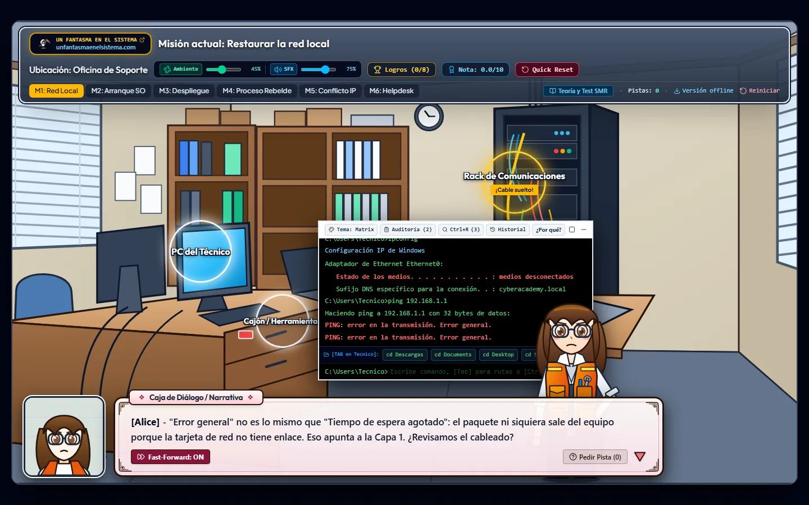
</p>

Alice, técnica de soporte, y tú atendéis las incidencias de una oficina: un equipo sin red, otro que no arranca, un despliegue que no puede molestar al empleado, un proceso que se come la CPU, una IP duplicada y un usuario al borde del llanto porque ha perdido tres horas de trabajo. Cada avería se diagnostica y se resuelve con las herramientas reales del oficio (`ping`, `ipconfig`, `nbtstat`, `tasklist`, `bootrec`…) en una consola que responde como Windows, y con las manos: conectando un latiguillo en el rack o arrancando desde un pendrive de rescate.

Pensado para el certificado de profesionalidad **IFCT0209 Sistemas Microinformáticos** y para el ciclo de FP de Grado Medio **SMR**.

> [!NOTE]
> Todo funciona en el navegador, sin servidor ni cuentas. El progreso se guarda en el `localStorage` del propio equipo.

## Índice

- [Las 6 misiones](#las-6-misiones)
- [Capturas](#capturas)
- [La consola](#la-consola)
- [Cómo se evalúa](#cómo-se-evalúa)
- [En el aula](#en-el-aula)
- [Desarrollo](#desarrollo)
- [Estructura](#estructura)
- [Novedades de la v2](#novedades-de-la-v2)
- [Créditos y licencia](#créditos-y-licencia)

## Las 6 misiones

| Misión | Módulo / UF (IFCT0209) | Incidencia |
| :---: | :--- | :--- |
| **M1 · Red local** | MF0220_2 · UF0855 | El equipo se ha quedado sin red y el LED de enlace de la tarjeta está apagado. ¿Fallo físico o de configuración? |
| **M2 · Arranque** | MF0219_2 · UF0852 | El PC muestra `BOOTMGR is missing` y no arranca. Hay que llegar a la consola de recuperación. |
| **M3 · Despliegue** | MF0221_2 | Ticket #304: instalar el antivirus corporativo en el equipo de un empleado nuevo sin que aparezca ninguna ventana. |
| **M4 · Proceso rebelde** | MF0219_2 · UF0853 | Lag terrible y CPU al 99 %. Algún programa colgado se está comiendo el equipo. |
| **M5 · Conflicto IP** | MF0220_2 · UF0855 | Windows avisa de un conflicto de dirección IP. ¿Con quién chocamos y por qué? |
| **M6 · Helpdesk** | MF0222_2 · UF0856 | Un usuario de contabilidad ha perdido el informe en el que llevaba tres horas y está muy alterado. |

Las misiones se pueden jugar en cualquier orden. El diálogo describe el **síntoma**, no el comando: Alice reacciona a lo que vas diagnosticando y el botón **Pedir pista** da la solución (y cuenta para la insignia *Expert Debugger*). Cada misión trae una ficha de teoría y una pregunta de autoevaluación en **Teoría y Test SMR**.

<details>
<summary><b>Solucionario para docentes</b> (contiene las soluciones)</summary>

| Misión | Diagnóstico | Resolución |
| :---: | :--- | :--- |
| M1 | `ping 127.0.0.1` responde; `ipconfig` da *medios desconectados*; `ping 192.168.1.1` da *Error general* (el paquete ni sale) | Rack de Comunicaciones → conectar el latiguillo → `ping 192.168.1.1` |
| M2 | `BOOTMGR is missing` (disco MBR, BIOS heredada) | Cajón → recoger el pendrive → PC del Técnico (arranca WinRE en `X:\Sources`) → `bootrec /fixmbr` y `bootrec /fixboot` |
| M3 | `cd Descargas`, `type ticket_304.txt`, `antivirus_setup.exe /?` (instalador NSIS) | `antivirus_setup.exe /S` — con **S mayúscula**: NSIS distingue mayúsculas y `/s` abre el asistente |
| M4 | `tasklist` (o `netstat -b`, `powercfg /energy`) señala `bucle.exe` (PID 4812) | `taskkill /F /IM bucle.exe` o `taskkill /F /PID 4812` (sin `/F` un proceso colgado no se cierra) |
| M5 | `ipconfig /all` (`192.168.1.50`, ámbito DHCP `.50–.200`) y `nbtstat -A 192.168.1.50` → es el NAS `NAS-CONTA-01`, con IP fija **dentro** del ámbito | `ipconfig /release` y `ipconfig /renew` (→ `192.168.1.105`). Solución definitiva: sacar la IP fija del ámbito, excluirla o crear una reserva |
| M6 | — | La respuesta que calma sin culpar **y** acompaña a recuperar la copia `.asd` (Archivo > Información > Administrar documento). Las cuatro respuestas salen en orden aleatorio y sin etiquetas |

</details>

## Capturas

| | |
| :---: | :---: |
| 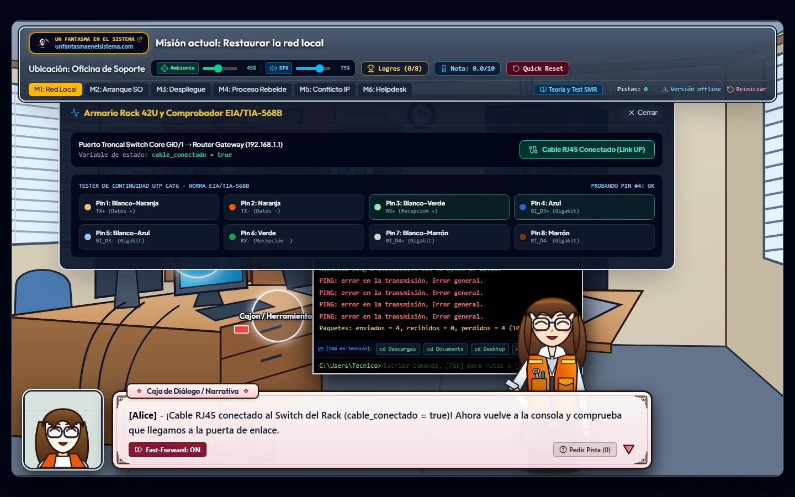 | 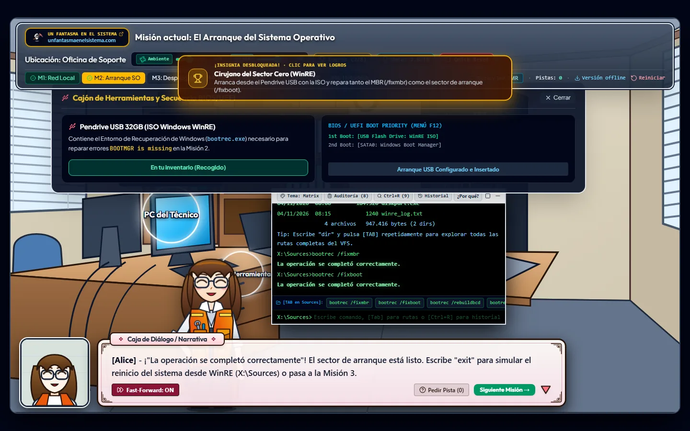 |
| Rack 42U y tester EIA/TIA-568B | M2: arranque desde el pendrive y `bootrec` en WinRE |
| 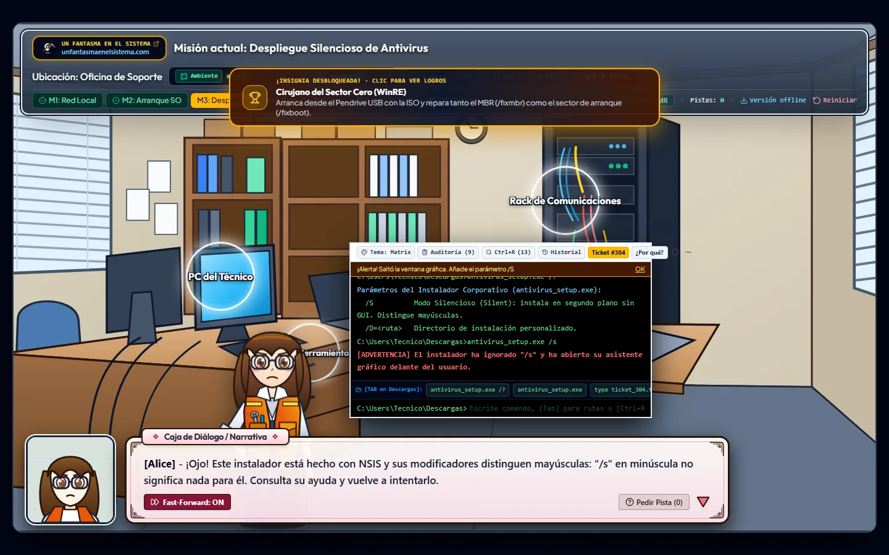 | 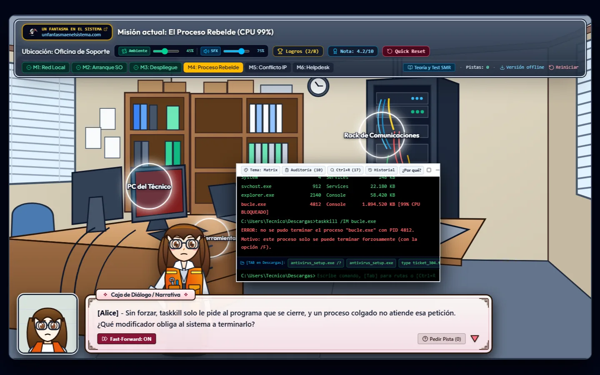 |
| M3: `/s` no es `/S` en un instalador NSIS | M4: `taskkill` sin `/F` no puede con un proceso colgado |
| 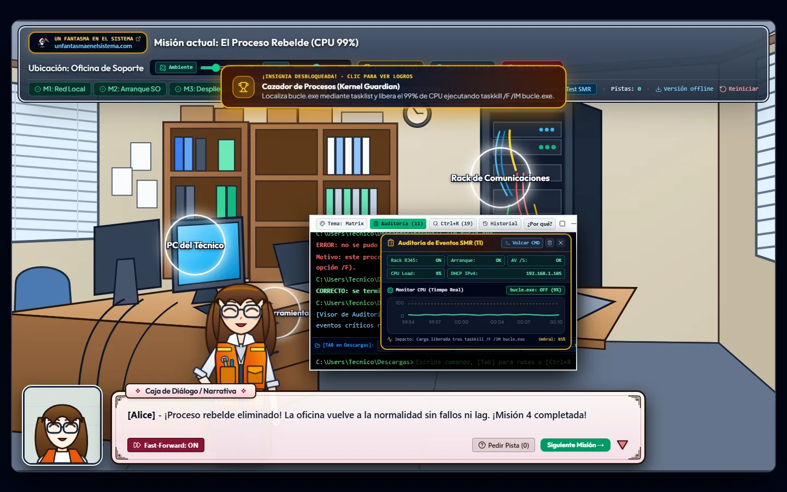 | 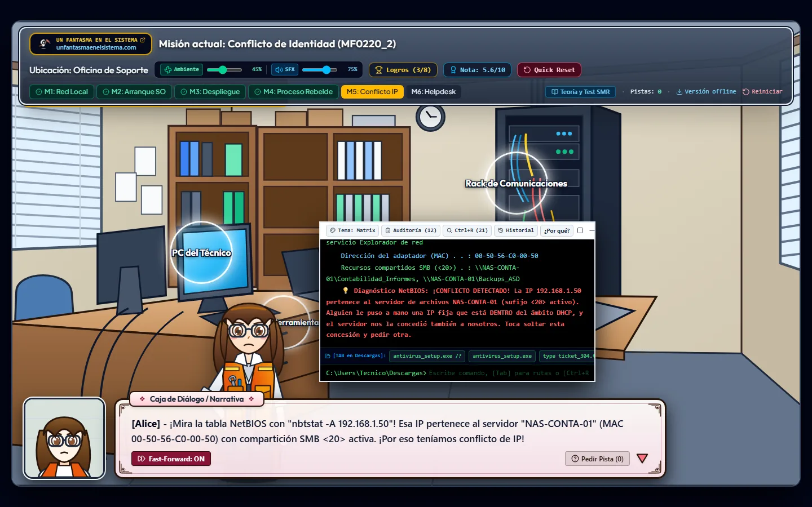 |
| Panel de auditoría (`audit`) con la CPU en tiempo real | M5: `nbtstat -A` descubre al NAS con IP fija dentro del ámbito |
| 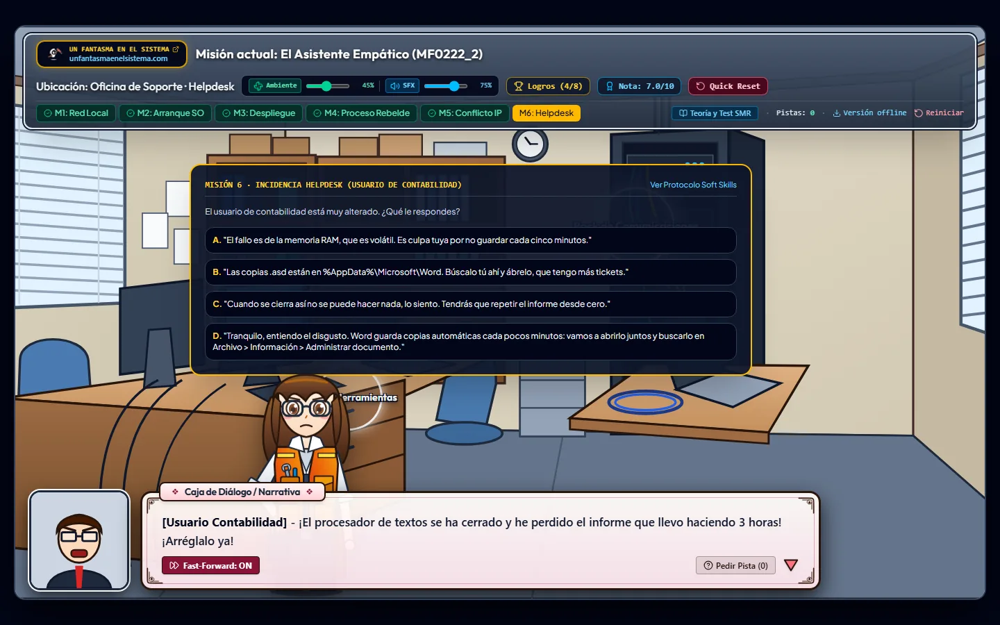 | 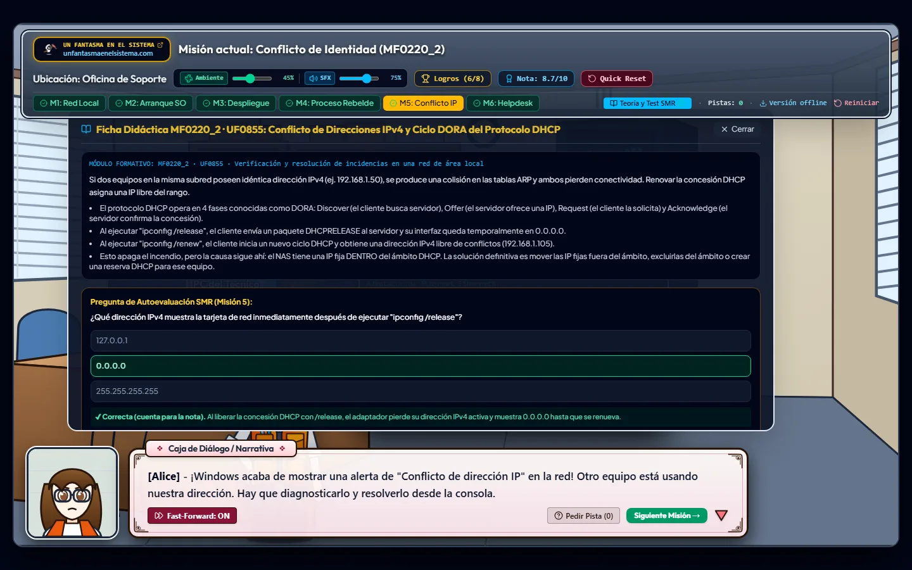 |
| M6: helpdesk con cuatro respuestas sin pistas visuales | Teoría y test de cada misión |
| 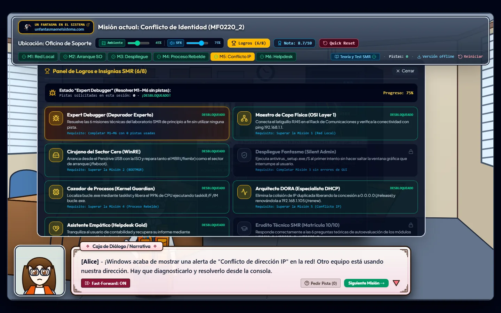 | 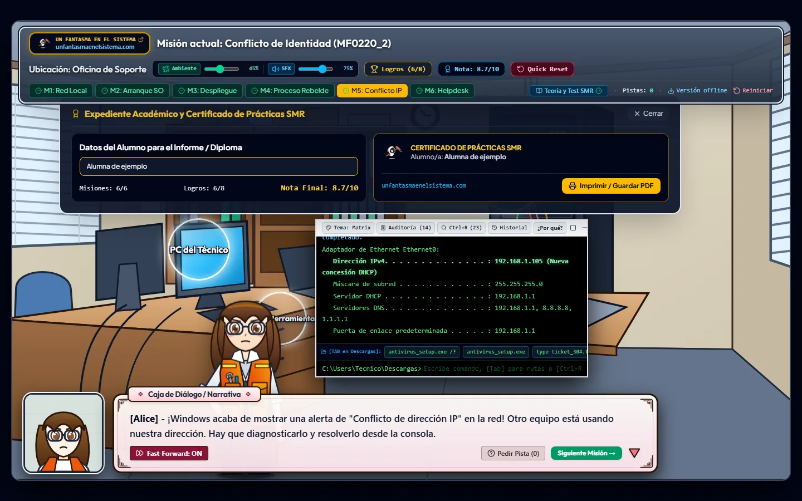 |
| Las 8 insignias | Expediente con nota, imprimible en PDF |

## La consola

La consola imita `cmd.exe` en español (y `X:\Sources` en WinRE) con un sistema de archivos virtual. Responde como Windows real, también cuando te equivocas: `bootrec` no existe fuera de WinRE, `taskkill` no encuentra un proceso que no está en marcha, `ipconfig /release` falla con los medios desconectados y un ejecutable no se encuentra si no estás en su carpeta.

| Comandos | Para qué |
| :--- | :--- |
| `ping`, `ipconfig` (`/all`, `/release`, `/renew`, `/displaydns`, `/flushdns`), `arp -a`/`-d`, `tracert`, `netsh interface show interface` | Diagnóstico de red por capas |
| `nbtstat -A`/`-n`/`-c`/`-R`, `netstat -ano`/`-b` | Nombres NetBIOS, conexiones y el ejecutable detrás de cada puerto |
| `tasklist`, `taskkill`, `powercfg /energy`/`/list`, `sfc /scannow` | Procesos, energía e integridad del sistema |
| `bootrec /fixmbr`/`/fixboot`/`/rebuildbcd`/`/scanos`, `exit` | Reparación del arranque (solo en WinRE) |
| `dir`, `cd`, `type`, `tree` (`/f`, `/a`), `cls` | Navegar por el sistema de archivos virtual |
| `ver`, `systeminfo`, `whoami`, `hostname`, `shutdown /r`/`/s` | Información del sistema y reinicio |
| `audit`, `eventvwr`, `history`, `theme`, `help` | Extras del simulador: panel de auditoría, historial y temas de color |

**Atajos:** `Tab` autocompleta comandos y rutas · `Ctrl+R` busca en el historial · `Ctrl+P`/`Ctrl+N` o `↑`/`↓` recorren el historial · `Ctrl+L` limpia · `Ctrl+C` interrumpe · `Ctrl+U`/`Esc` borran la línea.

## Cómo se evalúa

- **Nota sobre 10:** 1,4 puntos por misión (8,4) + 1,6 repartidos entre los 6 tests de teoría.
- **Tests:** solo cuenta el **primer intento**. Tras responder, la pregunta se cierra y muestra la explicación.
- **Las misiones solo se superan dentro de su misión.** Teclear desde la M1 los comandos de las demás no da puntos: la consola responde lo que respondería ese equipo.
- **Insignias:** una por misión (la de M3 exige no hacer saltar el asistente gráfico y la de M6 acertar a la primera), *Erudito Técnico* por acertar los 6 tests y *Expert Debugger* por superar las 6 misiones sin pedir ninguna pista.
- **Expediente:** el alumno escribe su nombre y lo imprime o lo guarda en PDF desde el propio navegador.

## En el aula

- **Versión offline:** el enlace *Versión offline* de la barra (o [este](https://unfantasmaenelsistema.github.io/CyberAcademySMR/cyberacademy-smr-offline.html)) descarga la app completa en **un único archivo `.html`** con todo incrustado. Funciona con doble clic desde un pendrive, sin Internet, y se puede subir a Moodle como recurso.
- **Progreso guardado:** recargar o cerrar el navegador no borra la partida (misiones, tests, insignias y nombre).
- **Equipos compartidos:** *Reiniciar* borra el progreso **y** el historial de comandos, para que el siguiente alumno no herede las soluciones del anterior.
- **Pantallas:** pensado para escritorio a partir de 1024 px de ancho.

## Desarrollo

Requiere [Bun](https://bun.sh/) (el proyecto se instala con `bun.lock`).

```bash
git clone https://github.com/unfantasmaenelsistema/CyberAcademySMR.git
cd CyberAcademySMR
bun install
bun run dev        # http://localhost:3000
```

```bash
bun run lint       # comprobación de tipos (tsc)
bun run test       # tests del motor de progreso (bun test)
bun run build      # dist/ + dist/cyberacademy-smr-offline.html
```

Cada `push` a `main` compila, pasa los tipos y los tests y publica `dist/` en GitHub Pages (`.github/workflows/deploy.yml`).

## Estructura

```text
├── docs/
│   ├── logo.png
│   └── capturas/                  # capturas reales de la app (WebP)
├── scripts/
│   └── build-offline.mjs          # genera la versión offline de un solo archivo
├── src/
│   ├── App.tsx                    # misiones, escena, diálogos e intérprete de comandos
│   ├── assets/icono.png           # logo de Un Fantasma en el Sistema (también favicon)
│   ├── components/
│   │   ├── AnimeAssets.tsx        # Alice y los retratos del diálogo (SVG)
│   │   ├── OfficeSceneSVG.tsx     # la oficina, el rack, el cajón y el PC
│   │   └── TerminalAuditPanel.tsx # panel de auditoría y gráfica de CPU (Recharts)
│   ├── data/smrCurriculum.ts      # teoría, tests, insignias, pines TIA-568B y sistema de archivos virtual
│   ├── engine/
│   │   ├── progress.ts            # guardado y validación del progreso, nota
│   │   └── progress.test.ts
│   └── utils/soundEffects.ts      # audio procedural (Web Audio API)
├── index.html
└── vite.config.ts
```

## Novedades de la v2

**Corrección de la evaluación**
- Los comandos de solución ya no superan misiones ajenas: desde la M1 se podían aprobar la M3, la M4 y la M5 (y sus insignias) tecleando sus comandos.
- El progreso se guarda y sobrevive a una recarga; *Reiniciar* borra también el historial de comandos.
- Los tests cuentan solo el primer intento (antes, tras fallar, la explicación daba la respuesta y se podía volver a pulsar).
- El diálogo inicial, el objetivo, los avisos de Windows, el ticket, la «guía rápida» del escritorio y las sugerencias de `Tab` ya no dictan el comando de la solución; queda para *Pedir pista*.
- M6: las respuestas ya no llevan la etiqueta «Empática y Correcta» en verde; son cuatro (una técnicamente correcta pero fría) y salen en orden aleatorio.

**Rigor técnico**
- Con el cable suelto, `ipconfig` muestra *medios desconectados* (antes, una IP APIPA 169.254.x.x, que significa otra cosa) y `ping` devuelve *Error general*, no *Tiempo de espera agotado*.
- M3: el instalador es NSIS y su `/S` distingue mayúsculas; `/s` abre el asistente. Hay que estar en `Descargas` o dar la ruta.
- M4: `taskkill` sin `/F` no cierra un proceso colgado; se aceptan los modificadores en cualquier orden.
- M5: el ámbito DHCP (`.50–.200`) ahora contiene la IP en conflicto, que es lo que explica el problema; la teoría añade la solución definitiva (exclusión o reserva).
- `bootrec` solo existe en WinRE; la teoría añade el caso UEFI/GPT (`bcdboot`) y el «Acceso denegado» de `/fixboot`.
- Códigos de módulo y UF corregidos para el IFCT0209 (p. ej., el helpdesk estaba en UF0860, que es imágenes y gráficos) y Autorrecuperación de Word separada de la de LibreOffice.
- Consola en español con una versión real de Windows 10.

**Interfaz y publicación**
- El terminal tapaba el anillo del Rack (justo el que pide la M1); ahora se coloca por debajo y no pisa el cajón ni la caja de diálogo.
- «Exportar HTML» generaba un mini‑juego distinto (sin M6, con el logo roto y que listaba todas las soluciones ante cualquier comando). Ahora es la app completa en un archivo.
- Fuera: dependencias sin uso (`@google/genai`, `express`, `dotenv`, `motion`…), la carpeta `.aistudio` y las «capturas» SVG dibujadas, sustituidas por capturas reales.
- Publicación en GitHub Pages con Bun, tipos y tests en cada `push`.

## Créditos y licencia

Creado por **[Un Fantasma en el Sistema](https://www.unfantasmaenelsistema.com)** para la formación práctica en sistemas microinformáticos.

Publicado bajo [licencia MIT](LICENSE).
