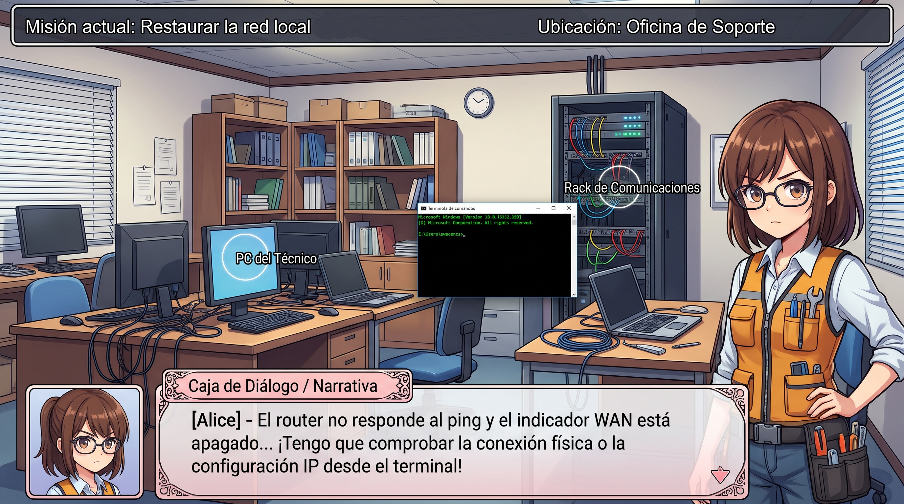
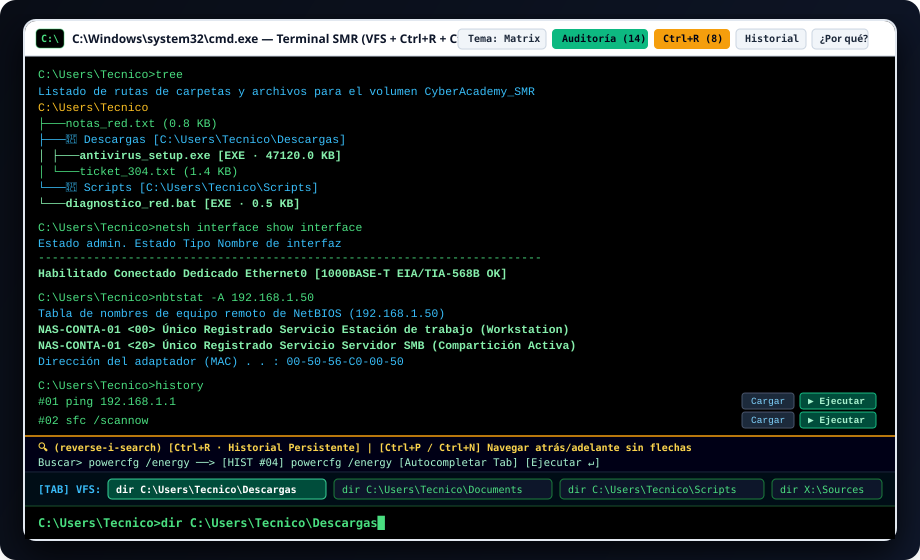
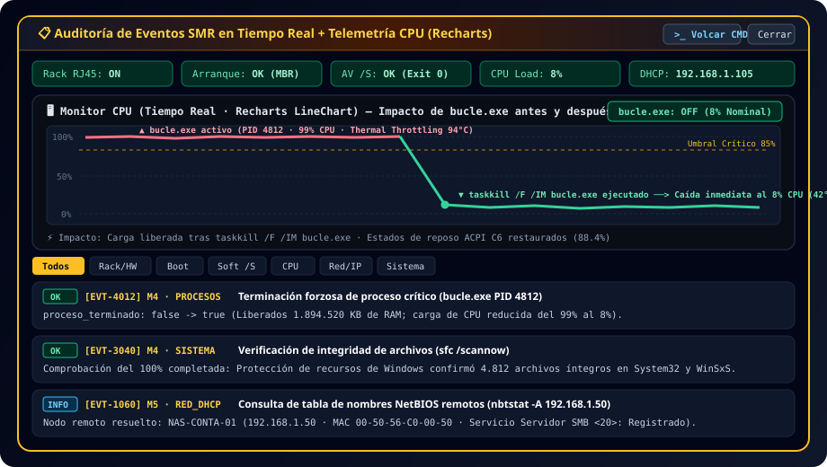
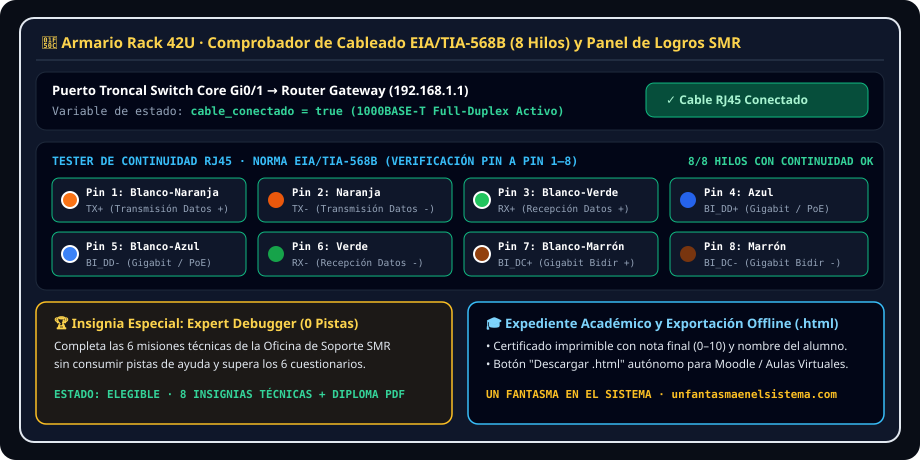

<div align="center">


# 🖥️ CyberAcademy SMR: Oficina de Soporte
### Simulador Interactivo *Point & Click* de Sistemas Microinformáticos y Redes (SMR)

[](https://react.dev/)
[](https://www.typescriptlang.org/)
[](https://vitejs.dev/)
[](https://tailwindcss.com/)
[](https://recharts.org/)
[](LICENSE)

Un videojuego educativo 2D estilo **Anime / Visual Novel ("Walking Simulator" & *Point-and-Click*)** diseñado para el aprendizaje práctico de los módulos formativos del certificado de profesionalidad **Sistemas Microinformáticos y Redes (SMR / IFCT0209)**.

Creado por **[Un Fantasma en el Sistema](https://www.unfantasmaenelsistema.com/)**.

</div>

---

## 📸 Capturas Reales de la Aplicación

### 1. Escena Principal de la Oficina de Soporte, Alice y Consola Interactiva (`cmd.exe`)
> Escenario 2D interactivo con **Alice** (desplazamiento horizontal suave mediante `window.moverAlice(destinoX, destinoY, mirarIzquierda)`), *hotspots* físicos sobre el **Armario Rack 42U**, **Cajón de Herramientas** y **PC del Técnico**, caja de diálogo ornamentada con retratos dinámicos y ventana de consola flotante.



---

### 2. Terminal Avanzado SMR (`VFS`, `tree`, `netsh`, `nbtstat`, `Ctrl+R` y `Ctrl+P`)
> Consola `C:\Windows\system32\cmd.exe` con **4 temas visuales** (*Matrix Green*, *Classic Windows 95*, *High Contrast*, *PowerShell Blue*), Sistema de Archivos Virtual (**VFS**) con autocompletado de rutas completas mediante `[Tab]`, búsqueda interactiva en tiempo real `[Ctrl+R]` (*reverse-i-search*) y navegación por historial con `[Ctrl+P]` / `[Ctrl+N]` y botones `[▶ Ejecutar]`.



---

### 3. Panel de Auditoría en Tiempo Real y Gráfica de CPU (`Recharts`)
> Panel flotante de auditoría (`audit` / `eventvwr`) con indicadores de estado hardware/red en vivo y un **monitor gráfico en tiempo real (`Recharts LineChart`)** que visualiza la saturación del **99% de CPU** provocada por el proceso rebelde `bucle.exe (PID 4812)` y su caída inmediata a valores nominales (**~8%**) tras ejecutar `taskkill /F /IM bucle.exe`.



---

### 4. Armario Rack 42U, Tester RJ45 (`EIA/TIA-568B`), Insignias y Certificado Académico
> Sub-vista interactiva del **Armario de Comunicaciones Rack 42U** con comprobador de continuidad pin a pin (**Pines 1 a 8 según norma EIA/TIA-568B**), sistema de **8 insignias desbloqueables** (incluyendo *Expert Debugger* al resolver las 6 misiones sin pistas) y generación de **Certificado Académico imprimible / PDF**.



---

## 🎯 Las 6 Misiones del Currículo SMR

| Misión | Módulo / Unidad Formativa | Incidencia Técnica en la Oficina | Resolución Práctica |
| :---: | :--- | :--- | :--- |
| **M1** | **Capa Física OSI (Capa 1)** | Sin conexión a la red local (`Destination host unreachable`). El latiguillo RJ45 del **Switch Core Gi0/1** está suelto en el Rack. | Inspeccionar el **Rack 42U**, verificar los 8 hilos **EIA/TIA-568B**, conectar el cable (`cable_conectado = true`) y comprobar con `ping 192.168.1.1` o `netsh interface show interface`. |
| **M2** | **MF0219_2 (UF0852) · Arranque** | Pantalla crítica **`BOOTMGR is missing`** al encender el equipo del técnico. | Recoger el **Pendrive USB ISO** del Cajón de Herramientas, insertarlo en el PC (`X:\Sources>`) y reparar el arranque con `bootrec /fixmbr`, `bootrec /fixboot` y `exit`. |
| **M3** | **UF0853 · Explotación y Scripts** | **Ticket #304**: Desplegar el antivirus corporativo sin mostrar ventanas gráficas que interrumpan al empleado. | Navegar a `C:\Users\Tecnico\Descargas` y ejecutar la instalación desatendida con el modificador silencioso: `antivirus_setup.exe /S`. |
| **M4** | **UF0853 · Gestión de Procesos** | El sistema sufre *lag* severo y *Thermal Throttling* porque `bucle.exe` consume el **99% de la CPU** y **1.89 GB de RAM**. | Diagnosticar con `tasklist`, `netstat -b` o `powercfg /energy` y terminar forzosamente el proceso con `taskkill /F /IM bucle.exe` (o `/PID 4812`). |
| **M5** | **MF0220_2 (UF0854) · Redes Locales** | Alerta de **Conflicto de dirección IPv4 duplicada (`192.168.1.50`)** con el servidor `NAS-CONTA-01`. | Diagnosticar con `ipconfig /all` o `nbtstat -A 192.168.1.50`, liberar la concesión actual con `ipconfig /release` (`0.0.0.0`) y solicitar una nueva con `ipconfig /renew` (`192.168.1.105`). |
| **M6** | **MF0222_2 (UF0860) · Helpdesk** | Usuario de contabilidad alterado tras cerrarse su procesador de textos con un informe de 3 horas sin guardar. | Aplicar **habilidades blandas (*Soft Skills* / empatía)** y guiarle a la ruta de **Autorecuperación (`Archivo > Información` · `.asd`)**. |

---

## 💻 Referencia Completa de Comandos del Terminal SMR

El emulador de consola soporta diagnóstico realista de red, procesos, energía, integridad de archivos y navegación por el **Sistema de Archivos Virtual (VFS)**:

| Comando | Descripción Técnica |
| :--- | :--- |
| `ping 192.168.1.1` / `ping 8.8.8.8` | Comprueba el alcance ICMP hacia el Gateway LAN o hacia Google Public DNS (`8.8.8.8` / `dns.google`) devolviendo `[SUCCESS]` o `[ERROR]` y poblando la caché DNS/ARP. |
| `ipconfig` / `ipconfig /all` | Muestra la configuración IPv4, estado del medio físico OSI Capa 1, servidores DHCP/DNS y un diagrama visual ASCII de la topología de red. |
| `ipconfig /displaydns` / `/flushdns` | Muestra la tabla dinámica de la caché de resolución DNS poblada tras pings exitosos o la vacía por completo. |
| `ipconfig /release` / `ipconfig /renew` | Libera la concesión DHCP en conflicto (`0.0.0.0`) y negocia el ciclo **DORA** (*Discover, Offer, Request, Acknowledge*) para obtener `192.168.1.105`. |
| `netsh interface show interface` | Muestra el **Estado administrativo** (`Habilitado`) frente al **Estado operativo/físico de Capa 1** (`Conectado` / `Desconectado`) de los adaptadores de red. |
| `arp -a` / `arp -d` | Consulta la tabla de traducción `IPv4 <-> MAC` o purga todas las entradas de la caché ARP forzando una nueva resolución por difusión (*Broadcast*). |
| `tracert <ip>` | Simula el seguimiento de ruta salto a salto (hasta 5 saltos WAN más allá del gateway `192.168.1.1`) con tiempos de respuesta RTT de 3 sondas por router. |
| `nbtstat -A <ip>` / `-n` / `-c` / `-R` | Consulta la tabla de nombres **NetBIOS sobre TCP/IP (`UDP 137`)** de un nodo remoto (`<00>` Estación, `<20>` Servidor SMB de compartición de red, `MAC`). |
| `netstat -b` / `netstat -ano` | Lista las conexiones TCP/UDP activas, sus estados (`LISTENING`, `ESTABLISHED`, `SYN_SENT`), el `PID` y el **nombre del ejecutable entre corchetes** (ej. `[bucle.exe]` en los puertos `4444` y `8080`). |
| `tasklist` / `taskkill /F /IM bucle.exe` | Lista los procesos en memoria y mata forzosamente el proceso descontrolado `bucle.exe` (`PID 4812`). |
| `powercfg /energy` / `powercfg /list` | Ejecuta un rastreo simulado de eficiencia energética y genera el resumen de `energy-report.html`, diagnosticando bloqueos de estados ACPI `C-State` y *Thermal Throttling* por alta carga de CPU. |
| `sfc /scannow` / `sfc /verifyonly` | Inicia una verificación progresiva (`0%` → `100%`) de los 4.812 archivos críticos de `System32` y del almacén `WinSxS`, confirmando que el sistema se encuentra saludable. |
| `bootrec /fixmbr` / `/fixboot` / `/rebuildbcd` | Herramientas del entorno de recuperación **WinRE (`X:\Sources>`)** para reparar el Master Boot Record, el sector de arranque y el almacén BCD. |
| `dir [ruta]` / `cd <ruta>` / `type <archivo>` | Explora cualquier carpeta del VFS (con autocompletado de rutas completas al pulsar `[Tab]`), cambia de directorio o muestra el contenido de archivos de texto. |
| `tree` / `tree /f` / `tree /a` | Visualiza en formato de árbol jerárquico anidado (`├───`, `└───`) todas las carpetas y archivos del Sistema de Archivos Virtual (VFS). |
| `history` / `history <n>` / `!<n>` / `!!` | Lista el historial persistente numerado con botones **`[Cargar]`** y **`[▶ Ejecutar]`**, filtra por texto o re-ejecuta comandos antiguos directamente por su índice. |
| `audit` / `eventvwr` | Abre el Panel Flotante de Auditoría del Sistema Virtual o vuelca el registro cronológico de eventos `EVT-*` en la consola. |
| `ver` / `systeminfo` / `whoami` / `hostname` | Muestra la versión exacta del SO, arquitectura de compilación **`x64-based system` (`AMD64`)**, memoria RAM física disponible y adaptadores. |
| `shutdown /r` / `shutdown /s` / `exit` | Simula un reinicio completo del sistema virtual (`/r` o `exit` desde WinRE) o muestra la pantalla de apagado ACPI S5 y minimiza el terminal (`/s`). |
| `theme <matrix\|win95\|contrast\|powershell>` | Cambia en caliente el esquema de color del terminal (también compatible con `color 0a`, `color 07`, `color 0e`, `color 1f`). |

---

## ⌨️ Atajos de Teclado de la Consola

| Atajo | Función |
| :---: | :--- |
| **`[Tab]`** | Autocompletado inteligente en bucle sensible al contexto y sugerencia automática de **rutas completas de carpetas del VFS** al usar `dir` o `cd`. |
| **`[Ctrl + R]`** | Abre el buscador interactivo en tiempo real (**`reverse-i-search`**) sobre el historial persistente de comandos (`localStorage`). |
| **`[Ctrl + P]` / `[Ctrl + N]`** | Navega hacia **atrás (`Ctrl+P`)** o hacia **adelante (`Ctrl+N`)** en el historial de comandos sin necesidad de usar las teclas de flecha. |
| **`[↑]` / `[↓]`** | Recorre los comandos anteriores y siguientes del historial persistente. |
| **`[Ctrl + L]`** | Limpia inmediatamente la pantalla del terminal (equivalente a `cls` / `clear`). |
| **`[Ctrl + C]`** | Interrumpe el comando o escaneo progresivo en curso (`sfc /scannow`) e imprime la señal `^C` (`SIGINT`). |
| **`[Ctrl + U]` / `[Esc]`** | Borra toda la línea de entrada actual o cierra el buscador `Ctrl+R`. |

---

## 🛠️ Tecnologías y Arquitectura del Proyecto

- **Frontend**: React 19 + TypeScript + Tailwind CSS 4.
- **Visualización en Tiempo Real**: `Recharts` (`LineChart` + `ResponsiveContainer`) integrado en el Panel de Auditoría para monitorizar el uso de CPU antes y después de finalizar `bucle.exe`.
- **Audio Procedural sin Dependencias Externas**: Motor de síntesis de sonido y bucle ambiental de oficina (*Web Audio API* en `src/utils/soundEffects.ts`) que simula el zumbido de ventiladores de servidores (con aceleración térmica en la Misión 4) y efectos mecánicos de teclado y conectores RJ45.
- **Exportación Autónoma Offline (`.html`)**: Utilidad integrada (`src/utils/standaloneExporter.ts`) que empaqueta la práctica en un único archivo `.html` autocontenido para subirlo a **Moodle** o ejecutarlo sin conexión en el aula.

```text
├── public/
│   ├── assets/aistudio/
│   │   ├── Gemini_Generated_Image_k6z8vpk6z8vpk6z8_c474940b.jpg  # Captura real de referencia de la escena
│   │   └── icono_81a3db5b.png                                    # Logotipo oficial Un Fantasma en el Sistema
│   └── screenshots/
│       ├── terminal-avanzado-smr.svg                             # Captura del Terminal CLI, VFS, tree, nbtstat y Ctrl+R
│       ├── panel-auditoria-recharts-cpu.svg                      # Captura del Panel de Auditoría y gráfica CPU Recharts
│       └── rack-tia568b-y-logros.svg                             # Captura del Rack 42U, Tester EIA/TIA-568B y Logros
├── src/
│   ├── components/
│   │   ├── AnimeAssets.tsx            # Sprites vectoriales de Alice y retratos dinámicos de la caja de diálogo
│   │   ├── OfficeSceneSVG.tsx         # Escenario 2D de la Oficina de Soporte, Rack 42U, Cajón y PC del Técnico
│   │   └── TerminalAuditPanel.tsx     # Panel Flotante de Auditoría + Gráfica Recharts de CPU en tiempo real
│   ├── data/
│   │   └── smrCurriculum.ts           # Fichas teóricas SMR, cuestionarios, pines TIA-568B, insignias y VFS
│   ├── utils/
│   │   ├── soundEffects.ts            # Sintetizador Web Audio API (ambiente de oficina + SFX interactivos)
│   │   └── standaloneExporter.ts      # Exportador de archivo único .html autónomo para aulas virtuales
│   ├── App.tsx                        # Máquina de estados de las 6 misiones, motor moverAlice e intérprete CLI
│   ├── index.css                      # Estilos globales Tailwind CSS y animaciones del escenario
│   └── main.tsx                       # Punto de entrada de React
├── index.html
├── package.json
├── tsconfig.json
├── vite.config.ts
└── LICENSE
```

---

## 🚀 Instalación y Ejecución Local

### 1. Clonar el repositorio

```bash
git clone https://github.com/tu-usuario/cyberacademy-smr-oficina-soporte.git
cd cyberacademy-smr-oficina-soporte
```

### 2. Instalar dependencias

```bash
npm install
```

### 3. Iniciar el servidor de desarrollo

```bash
npm run dev
```

La aplicación estará disponible en `http://localhost:3000`.

### 4. Compilar para producción y verificar tipos

```bash
npm run lint
npm run build
```

---

## 🌐 Créditos y Autoría

Desarrollado para la formación práctica de estudiantes de **Sistemas Microinformáticos y Redes (SMR)** por:

- **Proyecto Educativo**: [Un Fantasma en el Sistema](https://www.unfantasmaenelsistema.com/)
- **Licencia**: [MIT](LICENSE)
